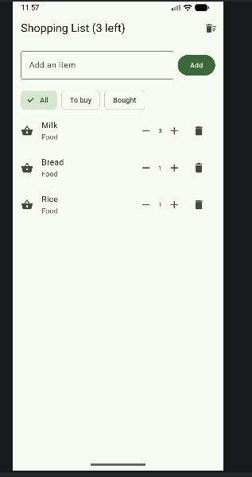
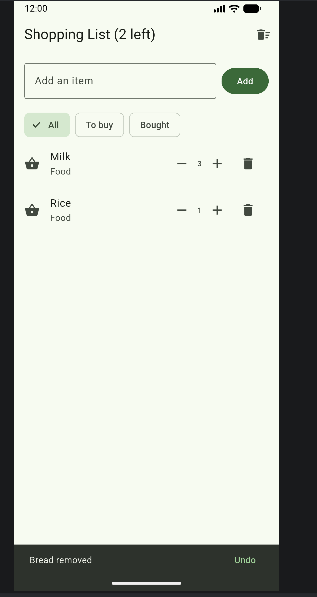
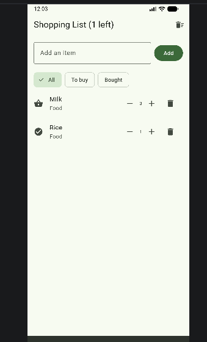
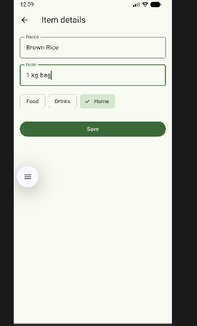

# Shopping List+

A Flutter shopping list app, built for Mobile Programming Week 2.

## Features
1. **Empty state:** when the list is empty, it shows "Your list is empty".
2. **Quantities:** every item has a quantity with − and + buttons. It never goes below 1.
3. **No duplicates:** adding an item that already exists (any capitals or spaces) increases its quantity and shows a message.
4. **Undo:** deleting an item shows an Undo button that puts it back in the same place with its quantity and bought status.
5. **Filters:** All, To buy and Bought chips. Bought items sit at the bottom of All.
6. **Item details:** a long-press opens a screen to edit the name, note and category (Food, Drinks, Home).

## Screenshots

## Think

**1. In part 5, why does deleting by index remove the wrong item when a filter is on? How did you fix it?**
With a filter on, the screen only shows part of the list, so row 0 on the screen is not item 0 in `items`. Deleting with the screen's index removes a different item and gives no error. I fixed it by taking the real `Item` from `visibleItems[index]` and removing it with `items.remove(item)`. For Undo, I save `items.indexOf(item)` before removing so it goes back in the right place.

**2. Why did you have to remove final from name? Why is final still a good choice for most fields?**
The details screen changes the name (`widget.item.name = name`), and a `final` field can only be set once. `final` is still good for most fields because it stops accidental changes and makes the code safer and easier to understand. Widget fields are `final` because widgets are rebuilt instead of changed.

**3. Why did you need a hot restart after adding quantity to Item, when a save was enough for everything else?**
Hot reload keeps the objects already in memory. The old `Item` objects were made from the old class without the new field, so the app and its data did not match. A hot restart starts the app again and builds all objects from the new class.

**4. The details screen changed the item, but the list only showed it after setState in .then. Why? What does this tell you about how Flutter decides when to redraw?**
The details screen changed the `Item` object, but the list's State was not told, so `build` did not run again. `.then` runs when the user comes back and calls `setState`, which makes Flutter call `build` and draw the new values. Flutter does not watch the data. It only redraws when `setState` tells it that something changed.